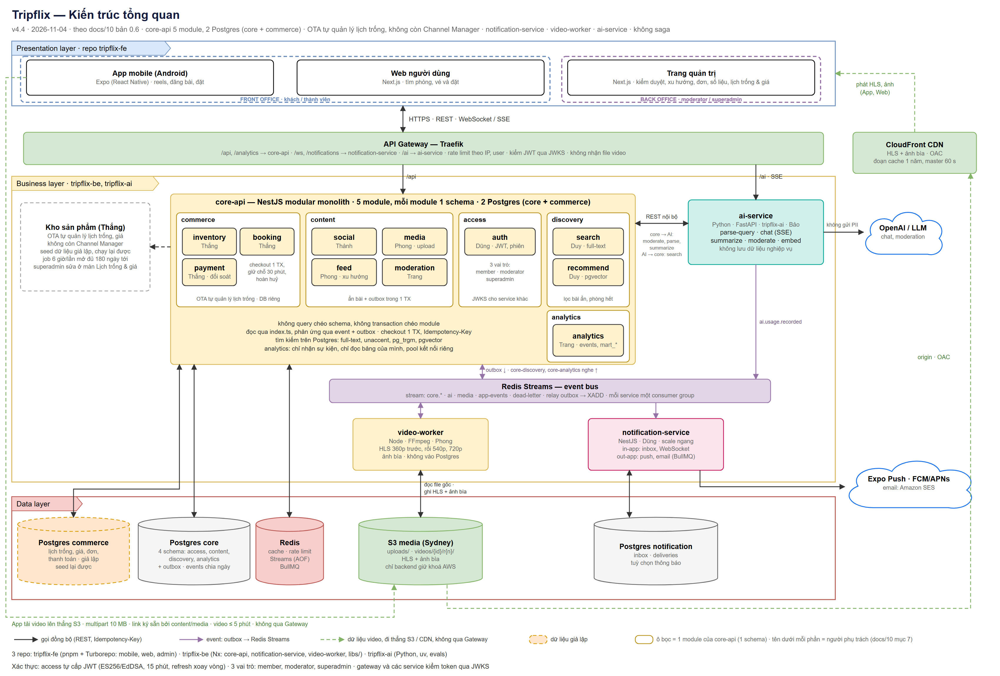

# Tripflix architecture guide — Backend

AI agents: read this file and [RULES.md](RULES.md) before changing code.

## Canonical system architecture

The diagram above is the canonical system view (v4.4, 2026-11-04). `tripflix-be` contains the NestJS modular `core-api` (five modules, two Postgres databases), `notification-service`, and `video-worker`. Front Office and Back Office are separate clients but share Traefik and `core-api`; Back Office APIs require `moderator` or `superadmin` roles checked by backend guards. Traefik routes API traffic to services. `core-api` publishes transactional outbox events to Redis Streams; notification and video processing consume their events. Media uploads and playback use S3 and CloudFront directly, not the API Gateway.

The [editable diagram](docs/architecture/06-kien-truc-tong-quan.drawio) is the source for the preview. Supporting decisions and repo structure are in [architecture doc 10](docs/architecture/10-de-xuat-kien-truc-va-repo.md), [architecture doc 11](docs/architecture/11-de-xuat-cau-truc-repo.md), and the [feed architecture](docs/architecture/10-nghiep-vu-kien-truc-feed.md). If a supporting document conflicts with the v4.4 diagram, flag the conflict and follow the diagram until the architecture is reconciled.

## Backend boundaries

- Keep module boundaries and database ownership described in the architecture docs. Modules communicate through their public `index.ts`; do not import another module's internals or query its schema.
- Enforce Back Office roles on the server for admin routes; client-side visibility is not an authorization check.
- Keep domain code independent of NestJS and Drizzle. Put transactions in application use cases and write events to the outbox in the same transaction.
- Generate contracts from their source; do not edit generated files by hand.
- Follow `RULES.md` for ownership, migrations, idempotency, checks, and branch workflow.
