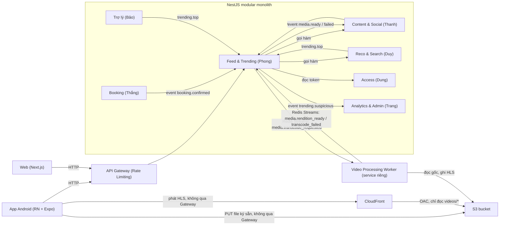
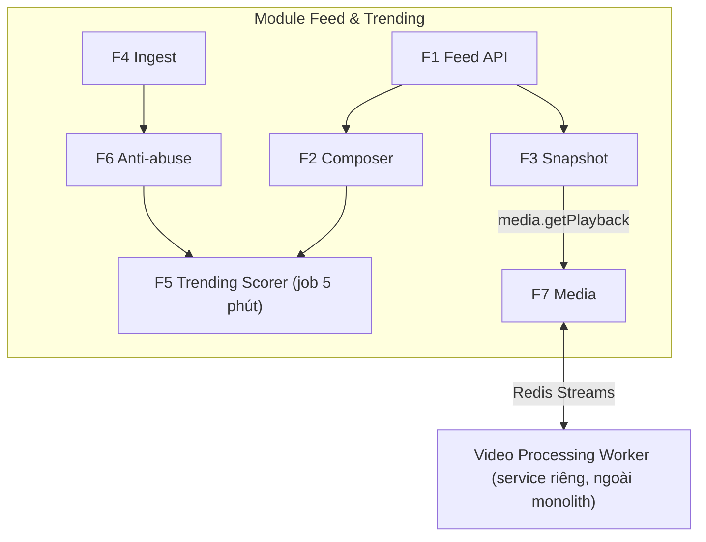
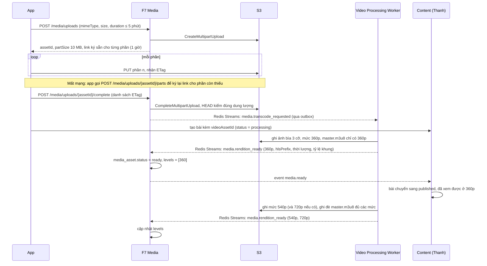
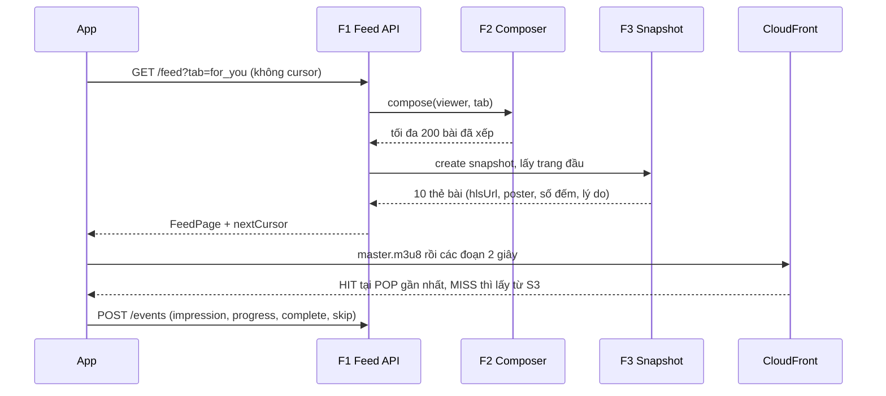
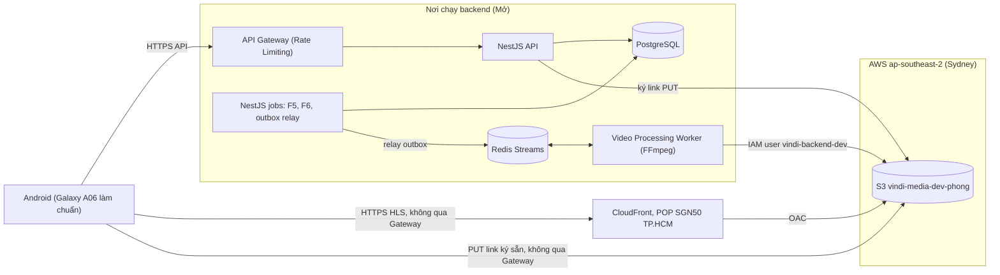

# Nghiệp vụ và kiến trúc — Feed & Trending, Media, App Android

Người viết: Nguyễn Thanh Phong · 03/11 · Gửi leader để tổng hợp sơ đồ kiến trúc phần mềm

- Phạm vi: module **Feed & Trending** (F1–F7) và phần nền tảng **App Android**.
- Chi tiết interface: `09-interface-feed-trending.md`. Riêng mục F7 trong file 09 còn ghi Mux, **file này thay thế mục đó** (đã chuyển sang S3 + CloudFront).
- **Cập nhật 03/11 theo [docs/10 bản 0.3](10-de-xuat-kien-truc-va-repo.md):** Feed và Media giờ là phần con của module `content` trong `core-api` (chung schema `content` với Social và Moderation, được join và dùng chung transaction). Analytics là module `analytics` của `core-api`, chỉ đọc kho sự kiện của nó (schema `analytics`), nên câu hỏi 4 ở mục 9 đã có đáp án (xem tại đó). Sơ đồ: [06-kien-truc-tong-quan](06-kien-truc-tong-quan.png).
- Ký hiệu trạng thái: **Chốt** = nhóm hoặc mentor đã quyết. **Đề xuất** = chờ duyệt. **Mở** = chưa có câu trả lời.

---

## 1. Tóm tắt một trang

| | |
| --- | --- |
| Feed làm gì | Trả bảng tin video du lịch cuộn dọc, xếp hạng xu hướng, nhận video người dùng tải lên và phát lại qua CDN |
| Kiến trúc | Modular monolith NestJS sau API Gateway. Event ghi vào bảng outbox, relay đẩy lên Redis Streams. Chuyển mã chạy ở Video Processing Worker (service riêng) (**Chốt** theo kiến trúc tổng) |
| App | React Native + Expo, TypeScript, một người code (**Chốt**) |
| Video | S3 + CloudFront. HLS tối đa 3 mức theo cạnh ngắn (360p, 540p, 720p nếu video gốc đủ lớn), trên 4G app giới hạn tối đa 540p. Video dài tối đa 5 phút, tải lên nhiều phần. Chuyển mã bằng FFmpeg trong Video Processing Worker (**Chốt**). File video không đi qua API Gateway |
| Dữ liệu Feed sở hữu | Sự kiện xem, tín hiệu và điểm xu hướng, snapshot, danh sách đã xem, tài sản video |
| Feed không sở hữu | Bài đăng, tương tác, theo dõi (Thanh) · gu (Duy) · tài khoản (Dung) · đặt chỗ (Thắng) · kiểm duyệt (Trang) |
| Luật ranh giới | Không đọc thẳng bảng của module khác. Chỉ gọi hàm hoặc nghe event |

---

## 2. Nghiệp vụ

### 2.1 Tác nhân

| Tác nhân | Làm gì với Feed |
| --- | --- |
| Khách (chưa đăng nhập) | Xem tab Dành cho bạn và Đang hot theo vùng. Không tương tác được |
| Người dùng | Xem 3 tab, tương tác, bấm Check giá, đặt chỗ từ bài |
| Người đăng bài (kể cả KOL) | Tải video lên, chờ xử lý, bài được đăng |
| Quản trị viên (màn A15 của Trang) | Nhận cờ bài bị đẩy ảo, quyết định ẩn bài |
| Module khác | Cấp dữ liệu cho Feed hoặc dùng điểm xu hướng của Feed |

### 2.2 Use case chính

| ID | Use case | Tác nhân | Sub-module |
| --- | --- | --- | --- |
| UC-01 | Xem bảng tin, cuộn không lặp bài | Khách, người dùng | F1, F2, F3 |
| UC-02 | Xem video mượt trên máy yếu, mạng yếu | Khách, người dùng | App, F7, CDN |
| UC-03 | Ghi nhận lượt xem và tương tác thành tín hiệu | App, module Thanh, Thắng | F4, F6 |
| UC-04 | Xem bảng xu hướng: bài, điểm đến, sản phẩm, KOL | Khách, người dùng, Duy, Bảo | F5 |
| UC-05 | Tải video lên và đăng bài | Người đăng bài | F7, module Thanh |
| UC-06 | Phát hiện và gắn cờ bài bị đẩy ảo | Hệ thống, quản trị viên | F6 |
| UC-07 | Xem lại khi mất mạng | Người dùng | App |

### 2.3 Luật nghiệp vụ

**Bảng tin (Chốt 3 tab; tỷ lệ là Đề xuất)**

| Tab | Nguồn bài | Cách xếp |
| --- | --- | --- |
| Dành cho bạn, đã đăng nhập | Gu (Duy) 60%, đang hot 30%, khám phá 10% | Xen kẽ 6 : 3 : 1 |
| Dành cho bạn, khách | Đang hot theo vùng 80%, khám phá 20% | Xen kẽ 8 : 2 |
| Đang hot | Top xu hướng theo vùng | Điểm giảm dần |
| Đang theo dõi | Bài 14 ngày gần nhất của người mình theo dõi | Mới nhất trước. Cần đăng nhập |

- Bài khám phá: đăng trong 48 giờ gần nhất, dưới 200 lượt hiển thị, chọn ngẫu nhiên.
- Mọi tab: bỏ bài trùng, bỏ 500 bài đã xem gần nhất, không để hai bài liền nhau cùng tác giả.
- Mỗi lần mở feed tạo một **snapshot** sống 30 phút, để cuộn không lặp và không sót bài.
- Bài bị ẩn biến mất ngay ở lần tải trang kế tiếp, vì Feed lọc theo `status` mỗi lần đọc.
- Mỗi thẻ bài có một dòng lý do, ví dụ "Đang hot ở Phú Quốc".
- Thẻ bài không chứa giá. Bấm Check giá thì app gọi Booking (Thắng).

**Xu hướng (Đề xuất)**

- `điểm = log10(1 + Σ trọng_số × 0,5^(tuổi_tương_tác / 48h))`. Cứ 2 ngày không ai tương tác thì điểm giảm một nửa. Điểm cập nhật 5 phút một lần.
- "Xem đủ": xem tối thiểu 15 giây hoặc 50% thời lượng, mốc nào tới trước. Không dùng "xem hết", vì video dài tới 5 phút gần như không ai xem hết, công thức sẽ thiên vị video ngắn.
- Trọng số: xem đủ 1, thích 1, bình luận 2, lưu 3, chia sẻ 4, Check giá 5, đặt chỗ từ bài 15.
- Đơn vị xu hướng (**Chốt**): bài, điểm đến, sản phẩm, KOL. Có bảng toàn quốc và theo vùng.

**Chống đẩy ảo (Đề xuất)**

- Mỗi người, mỗi thiết bị chỉ tính một lần cho mỗi loại tương tác trên mỗi bài.
- Tài khoản tạo chưa đủ 24 giờ: trọng số × 0,2. Khách: chỉ tính xem đủ, × 0,5.
- Trong 15 phút, tín hiệu vượt 10 lần mức thường **và** hơn 50% từ tài khoản mới: gắn cờ, gửi sang A15, giữ bài khỏi tab Đang hot. Feed không tự ẩn bài.

**Video (Chốt S3 + CDN, 5 phút, 540p; dung lượng 1 GB là Đề xuất)**

- Giới hạn tải lên: tối đa **5 phút** (**Chốt** với leader và nhóm, thay cho 60 giây trong PRD), 1 GB (**Đề xuất**: video 5 phút quay bằng điện thoại khoảng 400–700 MB), `video/mp4` hoặc `video/quicktime`.
- Tải lên nhiều phần (S3 multipart, mỗi phần 10 MB). Mất mạng thì app tải tiếp từ phần chưa xong, không tải lại từ đầu.
- Bài ở trạng thái `processing` tới khi xong mức 360p, rồi chuyển `published`. Các mức 540p, 720p thêm vào sau (mục 5.3).
- File gốc bị xoá sau 7 ngày.
- Chất lượng phát: trên 4G app giới hạn tối đa 540p (**Chốt**, thay cho 480p trong PRD), Wi-Fi cho lên 720p nếu video có mức đó. Mạng rất yếu thì hiện ảnh bìa, chạm mới phát.
- Ảnh bìa làm sẵn 3 cỡ ngay lúc chuyển mã, không resize động trên CDN (mentor trả lời câu hỏi mở số 2 của PRD).
- "Lưu" là đánh dấu bài, không tải file video về máy (**Chốt**). Khi mất mạng chỉ phát được video còn trong bộ nhớ đệm 200 MB trên máy.

---

## 3. Kiến trúc logic

### 3.1 Bối cảnh: Feed và các module khác



### 3.2 Bảy sub-module bên trong Feed



| Sub-module | Vai trò | Giao tiếp |
| --- | --- | --- |
| F1 Feed API | Điểm vào cho app và web. Không chứa logic xếp hạng | `GET /feed`, `GET /trending` |
| F2 Composer | Trộn nguồn bài theo tab và luật | Gọi `reco.getCandidates`, `trending.top`, `social.getFollowees`, `content.listByAuthors` |
| F3 Snapshot | Giữ danh sách xếp sẵn 30 phút, phân trang bằng cursor | Gọi `content.getPosts`, `social.getCounts`, `social.getViewerState`, `media.getPlayback` |
| F4 Ingest | Nhận sự kiện xem, chuẩn hoá thành tín hiệu. Dùng chung với Analytics | `POST /events` (lô ≤ 50), nghe `post.*`, `booking.confirmed` |
| F5 Scorer | Cộng dồn điểm có bán rã, gộp theo đơn vị | Job 5 phút; cấp `trending.top`, `trending.scoreOf` |
| F6 Anti-abuse | Chỉnh trọng số khi ghi, quét đột biến sau mỗi lần F5 chạy | Phát `trending.suspicious` |
| F7 Media | Cấp link tải lên nhiều phần, kiểm file, giao việc chuyển mã, trả link phát và ảnh bìa | `POST /media/uploads`, `POST /media/uploads/:assetId/parts` (ký thêm link cho phần còn thiếu), `POST /media/uploads/:assetId/complete`; phát `media.transcode_requested` cho worker; nghe `media.rendition_ready`, `media.transcode_failed`; phát `media.ready`, `media.failed` |

### 3.3 Thành phần trong app

| Thành phần | Việc |
| --- | --- |
| `FeedScreen` | 3 tab, cuộn dọc mỗi lần một bài (FlatList, đã chạy ổn trong `feed-demo`) |
| `PlayerPool` | Cố định 3 trình phát `expo-video` (bài trước, hiện tại, kế tiếp). Máy Android chỉ có vài bộ giải mã phần cứng. Bài mới bắt đầu phát ngay khi lướt qua nửa màn hình, việc nặng (thay nguồn) đợi tới khi trang dừng hẳn |
| `Preloader` | Hai bài bên cạnh tải trước 4 giây đầu. Bài đang xem giữ bộ đệm 30 giây, vì ExoPlayer cần có sẵn ít nhất 10 giây mới lên chất lượng |
| `EventQueue` | Gom sự kiện, gửi mỗi 10 giây, khi đủ 20 sự kiện hoặc khi app vào nền. Lưu lại lúc mất mạng |
| `OfflineStore` | 10 thẻ gần nhất và danh sách bài đã lưu (chữ và ảnh bìa) |
| `PendingActions` | Hàng đợi thích, lưu lúc mất mạng |
| `UploadFlow` | Chọn video → xin link → tải thẳng lên S3 từng phần 10 MB → báo xong → tạo bài. Lưu `assetId` và các phần đã xong để tải tiếp khi có mạng lại |

---

## 4. Luồng chính

### 4.1 Đăng video (UC-05)



### 4.2 Xem feed và phát video (UC-01, UC-02)



### 4.3 Tính xu hướng (UC-03, UC-04, UC-06)

1. Sự kiện từ app (`POST /events`) và event `post.*`, `booking.confirmed` vào F4.
2. F4 loại trùng theo `eventId`, lấy `userId`/`deviceId` từ token, ghi `interaction_raw`. Tín hiệu "xem đủ" sinh từ sự kiện `progress` khi vượt 15 giây hoặc 50% (chỉ một lần mỗi lượt xem).
3. F6 chỉnh trọng số rồi ghi `trend_signal`.
4. 5 phút một lần, F5 cộng tín hiệu mới vào `trending_score`, gộp theo bài, điểm đến, sản phẩm, KOL.
5. F6 quét đột biến 15 phút, nếu có thì phát `trending.suspicious`.

---

## 5. Dữ liệu

### 5.1 Bảng Feed sở hữu (schema `feed`, PostgreSQL)

| Bảng | Khoá | Giữ gì |
| --- | --- | --- |
| `interaction_raw` | `event_id` | Sự kiện xem thô, chỉ Feed đọc. Analytics không đọc bảng này mà lấy sự kiện từ `stream:app-events` vào schema `analytics` (mục 9, câu 4) |
| `trend_signal` | `(actor_key, post_id, kind)`, `(device_id, post_id, kind)` | Tín hiệu đã chỉnh trọng số |
| `trending_score` | `(entity, entity_id, region)` | Điểm cộng dồn `raw`, `updated_at` |
| `snapshot` | `id` | `viewer_key`, `tab`, `post_ids uuid[]`, `expires_at`. Kiến trúc tổng đã có Redis, nên chuyển sang Redis (key hết hạn sau 30 phút) nếu đo thấy chậm |
| `seen_post` | `(viewer_key, post_id)` | 500 bài đã xem gần nhất mỗi viewer |
| `media_asset` | `id` | `owner_id`, `status` (`uploading`, `processing`, `ready`, `failed`), `s3_upload_id` (multipart), khoá file gốc, `hls_prefix` (có số phiên bản), `levels` (các mức đã xong, ví dụ `{360,540}`), thời lượng, tỷ lệ khung, `transcode_attempts`, `error` |
| `outbox` | `id` | Theo mẫu chung của Dung |

### 5.2 Bố cục file trên S3

```
uploads/{assetId}/original.mp4                ← file gốc, tự xoá sau 7 ngày
videos/{assetId}/r{n}/master.m3u8             ← danh sách mức chất lượng
videos/{assetId}/r{n}/{360p,540p,720p}/index.m3u8, seg_###.ts
videos/{assetId}/r{n}/poster_{360,540,720}.jpg ← ảnh bìa 3 cỡ theo chiều rộng
```

- Mức chất lượng tính theo cạnh ngắn của video gốc. Video dọc: 360×640, 540×960, và 720×1280 chỉ khi cạnh ngắn của video gốc từ 720 trở lên (không phóng to). Đoạn cuối mỗi mức được kiểm tra dài ít nhất 0,5 giây, tránh video đứng ở cuối.
- Ảnh bìa làm theo chiều rộng pixel chứ không theo inch, vì máy 5,5 inch và 6,5 inch có thể cùng rộng 720 pixel. App chọn cỡ nhỏ nhất không nhỏ hơn chiều rộng màn hình; lưới ảnh nhỏ dùng 360.
- `r{n}` là số lần chuyển mã. Đoạn video, playlist từng mức và ảnh bìa được cache 1 năm và không đổi (`immutable`), nên chuyển mã lại phải ghi sang thư mục mới, rồi cập nhật `media_asset.hls_prefix`.
- Riêng `master.m3u8` cache 60 giây, vì worker ghi đè nó khi xong thêm mức chất lượng. Người đang xem giữ master cũ (chỉ 360p) tới hết lượt xem, lượt sau mới thấy đủ các mức.
- Lifecycle: xoá `uploads/` sau 7 ngày, xoá phần tải dở (multipart) sau 1 ngày.

### 5.3 Giao việc cho Video Processing Worker

Worker là service riêng, **không có quyền vào PostgreSQL** của monolith. Nó chỉ đọc và ghi Redis Streams và S3.

- Không còn bảng `transcode_job`. Hàng đợi là stream `media.transcode`, trạng thái nằm ở `media_asset.status`.
- Worker đọc stream qua consumer group `video-worker`. Xong việc thì `XACK`. Nếu worker chết giữa chừng, việc còn treo trong danh sách chờ (PEL) và được worker khác nhận lại (`XAUTOCLAIM`) khi đã im lặng quá 2 phút.
- **Báo còn sống:** video 5 phút có thể chuyển mã lâu hơn ngưỡng nhận lại. Trong lúc làm, cứ 30 giây worker gọi `XCLAIM` việc đó cho chính nó (kèm `JUSTID`) để đặt lại thời gian im lặng. Nhờ vậy worker khác chỉ nhận lại việc khi worker cũ thật sự đã chết, không phải khi nó đang làm lâu.
- **Đăng sớm ở 360p:** worker làm mức 360p trước, ghi master chỉ có 360p rồi phát `media.rendition_ready`. F7 chuyển `ready` ngay, bài được đăng mà không phải chờ cả 3 mức. Các mức cao hơn xong dần, mỗi mức phát thêm một `media.rendition_ready`.
- Thử tối đa 3 lần (đếm theo số lần giao của Redis). Quá 3 lần thì worker phát `media.transcode_failed`, F7 chuyển `failed` và phát `media.failed`.
- Redis có thể giao một việc nhiều lần, nên worker ghi vào thư mục `r{n}` mới. F7 xử lý `media.rendition_ready` theo cặp `(assetId, mức)`: mức đã có trong `levels` thì bỏ qua, và chỉ phát `media.ready` một lần.
- Worker không có DB nên không có outbox: nó phát `media.rendition_ready` và `media.transcode_failed` thẳng lên Redis Streams (`XADD`), rồi mới `XACK` việc. Nếu chết giữa hai bước, việc được giao lại và F7 loại trùng như trên.
- Nếu 360p xong mà mức cao hơn lỗi quá 3 lần, bài vẫn giữ `ready` ở 360p, F7 ghi `error` để xem lại. Chỉ khi 360p lỗi mới chuyển `failed`.
- Video 5 phút chuyển mã lâu hơn nhiều so với clip thử. Mỗi worker chạy tối đa 1 việc cùng lúc; cần nhiều hơn thì thêm worker vào cùng consumer group.

### 5.4 Event

| Hướng | Event | Đối tác |
| --- | --- | --- |
| Nghe | `post.liked`, `post.unliked`, `post.commented`, `post.saved`, `post.unsaved`, `post.shared` | Thanh |
| Nghe | `booking.confirmed` (có `sourcePostId`) | Thắng |
| Phát | `media.ready`, `media.failed` | Thanh |
| Phát | `media.transcode_requested` | Video Processing Worker |
| Nghe | `media.rendition_ready` (mỗi mức một lần), `media.transcode_failed` | Video Processing Worker |
| Phát | `trending.suspicious` | Trang |

Mọi event ghi vào bảng `outbox` trong cùng transaction với dữ liệu, rồi relay đẩy lên Redis Streams. Mỗi module nghe bằng một consumer group riêng. Redis Streams giao **ít nhất một lần**, nên hàm xử lý event của Feed loại trùng theo `eventId`.

---

## 6. Kiến trúc triển khai



| Thành phần | Hiện trạng (môi trường dev) |
| --- | --- |
| S3 | Riêng tư, chặn toàn bộ truy cập công khai. Region bị khoá ở Sydney do tài khoản thuộc AWS Organization |
| CloudFront | OAC, chỉ đọc `videos/*`. CORS và header đo lường (`X-Cache`, `X-Amz-Cf-Pop`, `Age`) đã bật. Dùng tên miền mặc định `*.cloudfront.net` |
| Quyền backend | IAM user `vindi-backend-dev`: ghi/đọc/xoá `uploads/*` và `videos/*`. Khoá truy cập cần đổi vì đã lộ |
| API Gateway | Chỉ nhận API. HLS và file tải lên đi thẳng CloudFront và S3: mỗi video có hàng chục request lấy đoạn, đi qua Gateway sẽ bị Rate Limiting chặn |
| Rate Limiting cho Feed | `POST /events` nhận lô tối đa 50 sự kiện, app gửi khoảng 10 giây một lần. Đề xuất giới hạn 30 request/phút mỗi thiết bị, tách riêng khỏi giới hạn chung |
| Redis | Redis Streams cho event và việc chuyển mã. Có thể dùng thêm cho `snapshot` |
| Backend, CSDL | Chưa có. Chờ mentor trả lời nơi chạy |
| App | Có bản thử `feed-demo` (Expo, chạy bằng Expo Go): feed dọc, 3 trình phát luân phiên, tải trước, tua, dòng đo TTFF và số lần đứng hình. Chưa ghi số đo trên máy thật. Có thêm trang Stream Lab (web) |

---

## 7. Yêu cầu phi chức năng

| Chỉ số | Ngưỡng | Đo được đến nay |
| --- | --- | --- |
| Tới khung hình đầu (TTFF) | < 1 s trên 4G yếu | Wi-Fi, Stream Lab: trung vị 99 ms khi tải trước, 182 ms khi không tải trước |
| Thời gian chờ khi CDN chưa có đoạn (MISS) | Càng thấp càng tốt | 620–760 ms, vì S3 ở Sydney |
| Dừng để tải | < 1 lần mỗi 10 video | Chưa đo đủ phiên |
| Tua tới đoạn đã tải | Tức thì | 13 ms |
| Video đầu tiên phát sau khi mở app (PRD) | ≤ 3 s trên Galaxy A06 | Chưa đo trên máy thật |
| Khởi động nguội app | < 5 s, mục tiêu 2 s | Chưa đo trên máy thật |
| Từ lúc tải lên xong tới lúc xem được | Đo, chưa có ngưỡng | Đã có script chuyển mã, chưa đo với video 5 phút |

**Mức chất lượng HLS** (đoạn 2 giây, audio AAC 96 kbps, không làm 1080p vì màn Galaxy A06 rộng 720 điểm; trên 4G app giới hạn tối đa 540p):

| Mức | Video mục tiêu | Đo thực tế (trung bình / đỉnh) |
| --- | --- | --- |
| 360p | 365 kbps | 506 / 669 kbps |
| 540p | 1.100 kbps | 1.237 / 1.788 kbps |
| 720p | 2.000 kbps | 2.144 / 3.136 kbps |

Ở mạng 400 kbps, trình phát tự hạ từ 720p xuống 360p nhưng 360p vẫn vượt băng thông. Đề xuất thêm mức khoảng 240p hoặc giảm audio xuống 64 kbps.

---

## 8. Quyết định kiến trúc

| # | Quyết định | Lý do | Đánh đổi | Trạng thái |
| --- | --- | --- | --- | --- |
| D1 | Modular monolith + outbox + Redis Streams | Nhóm 7 người, 4 tuần, một lần triển khai | Phải giữ kỷ luật ranh giới bằng code review. Event có thể tới trùng | Chốt |
| D2 | React Native + Expo | Web dùng React, Expo lo build Android | Trình phát phụ thuộc `expo-video` | Chốt |
| D3 | S3 + CloudFront thay Mux | Mentor chọn | Phải tự chuyển mã | Chốt |
| D4 | App tải thẳng lên S3 nhiều phần (multipart), mỗi phần 10 MB có link ký sẵn | Backend không phải nhận file lớn. Video tới 5 phút, PRD yêu cầu mất mạng thì tải tiếp | App phải nhớ các phần đã xong. Phần tải dở bị S3 xoá sau 1 ngày | Chốt |
| D5 | HLS tối đa 3 mức theo cạnh ngắn, đoạn 2 giây, bắt đầu 360p. Trên 4G tối đa 540p | Khung hình đầu nhanh trên mạng yếu. 540p thay cho 480p của PRD vì demo đã chạy và đo với 540p | Thêm request, thêm file trên S3 | Chốt |
| D6 | Snapshot 30 phút | Cuộn không lặp, không sót bài | Bài mới không chen vào phiên đang xem | Đề xuất |
| D7 | Điểm cộng dồn có bán rã, job 5 phút | Mỗi lần chạy chỉ xử lý tín hiệu mới | Xu hướng trễ tối đa 5 phút | Đề xuất |
| D8 | Đường dẫn video có số phiên bản `r{n}` | Cache CDN 1 năm, không xoá được bản cũ đã cache | Phải cập nhật `hls_prefix` khi chuyển mã lại | Đề xuất |
| D9 | Chuyển mã bằng FFmpeg trong Video Processing Worker, nhận việc qua Redis Streams | Kiến trúc tổng tách worker thành service riêng. Đã có script FFmpeg chạy được (`stream-lab/transcode.sh`) | Tự vận hành worker. Chuyển mã nặng CPU, cần giới hạn số việc chạy cùng lúc | Chốt |
| D10 | Video không đi qua API Gateway | Tránh Rate Limiting và tải băng thông lên Gateway | Bảo vệ file video bằng OAC và link ký sẵn, không bằng Gateway | Đề xuất |
| D11 | Ảnh bìa làm sẵn 3 cỡ (rộng 360, 540, 720) lúc chuyển mã | Mentor chọn làm sẵn thay vì resize động | Thêm 3 file mỗi video | Chốt |
| D12 | Video tối đa 5 phút | Leader và nhóm chốt | Chuyển mã lâu hơn, file gốc lớn hơn, bắt buộc tải nhiều phần | Chốt |

Các phương án đã cân nhắc và bỏ: Mux, Bunny (mentor chọn S3), MinIO + Cloudflare (phải tự vận hành; điều khoản Cloudflare hạn chế video ở gói thường). MinIO vẫn dùng được cho môi trường local. Cloudflare R2 là phương án khi cần giảm phí băng thông.

---

## 9. Rủi ro và câu hỏi mở

**Rủi ro**

- Một người code app chứa màn hình của cả 7 module. Cần API ổn định từ tuần 2.
- Script chuyển mã (`stream-lab/transcode.sh`) đã chạy được với 22 clip. Việc còn lại là đóng nó thành worker đọc Redis Streams, ước 2–3 ngày công. Dự phòng: tạm phát MP4 540p qua CDN (khung hình đầu trên 3G khoảng 5,8 s thay vì 2,1 s).
- Video 5 phút: chuyển mã lâu, người đăng chờ lâu mới thấy bài lên. Cần đo thời gian thật và báo trạng thái "Đang xử lý" trên app.
- S3 ở Sydney làm lần xem đầu mỗi đoạn chậm thêm khoảng 650 ms.
- Lỗi đoạn cuối quá ngắn làm video đứng ở cuối (5/15 clip thử) **đã sửa**: bước chuyển mã kiểm tra đoạn cuối và làm lại nếu quá ngắn.

**Cần mentor trả lời**

1. Link video công khai hay phải ký (signed URL)?
2. Dùng tài khoản AWS công ty được không? Tài khoản hiện tại bị khoá ở Sydney.
3. Backend và CSDL chạy ở đâu?

**Cần nhóm trả lời**

1. Thanh: event `post.*` có kèm `deviceId`? Bài ở `processing` tới khi có `media.ready`?
2. Ai quản lý danh sách vùng (`RegionCode`)?
3. Dung: `isKol` có trong token không?
4. Trang: Analytics cần đọc `feed.interaction_raw`. Coi bảng này là interface công khai (ghi vào luật ranh giới như một ngoại lệ), hay Feed phát event để Analytics tự giữ bản sao?
   **Chốt (03/11):** không đọc bảng. Sự kiện xem từ `POST /events` đi vào `stream:app-events`; Feed phát thêm `trend.updated`, `trend.fraud_suspected` qua outbox. Module `analytics` nghe bằng consumer group `core-analytics` và ghi vào schema `analytics` (docs/10 mục 3.6).
5. Thanh: ảnh trong vlog (tối đa 10 ảnh) có cần làm sẵn nhiều cỡ không, và do module nào làm? Worker video làm được nếu cần.
6. Trang: video có phải qua kiểm duyệt của AI Gateway trước khi đăng không? Nếu có, thêm một bước giữa `media.ready` và lúc bài chuyển sang `published`.
