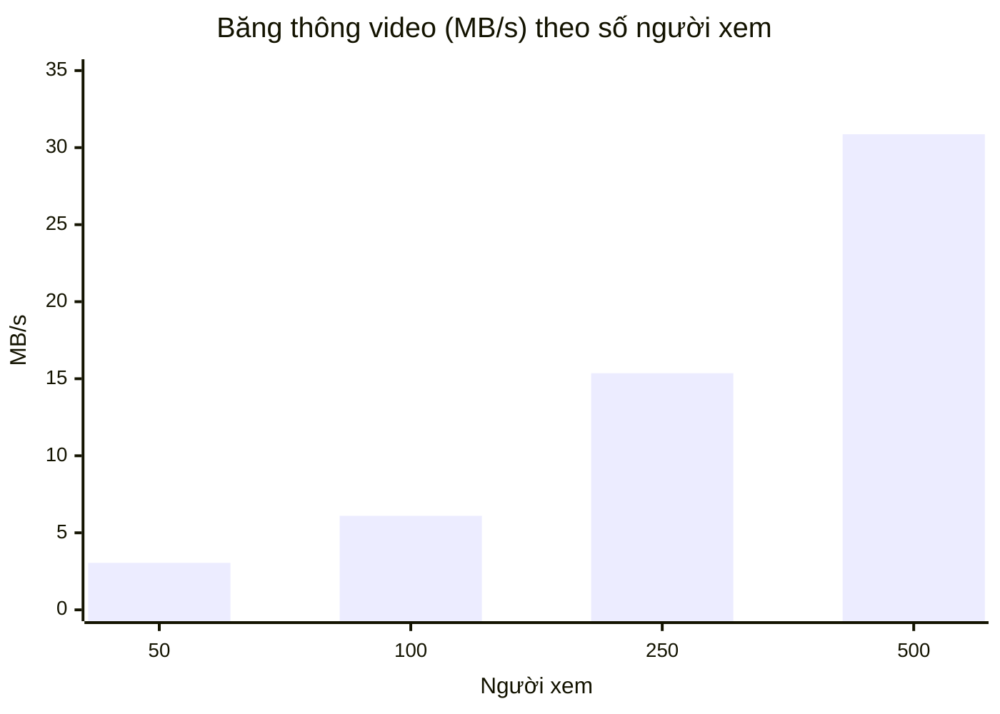
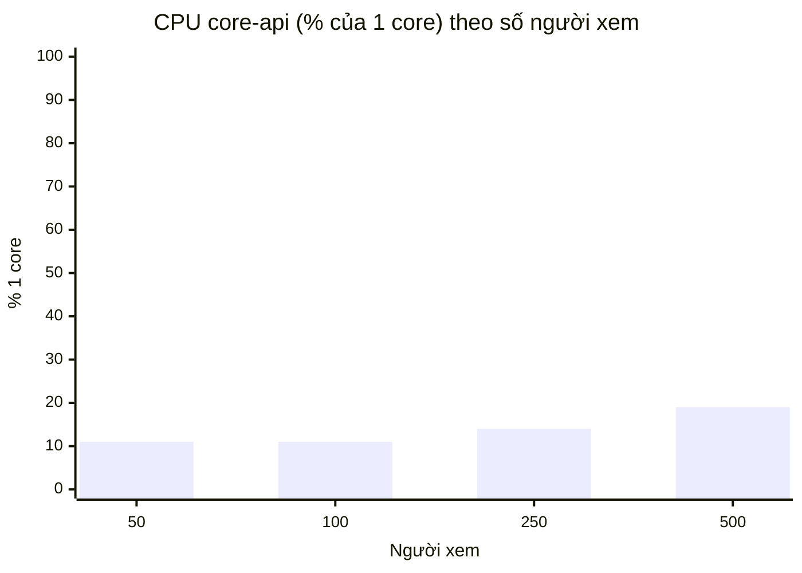
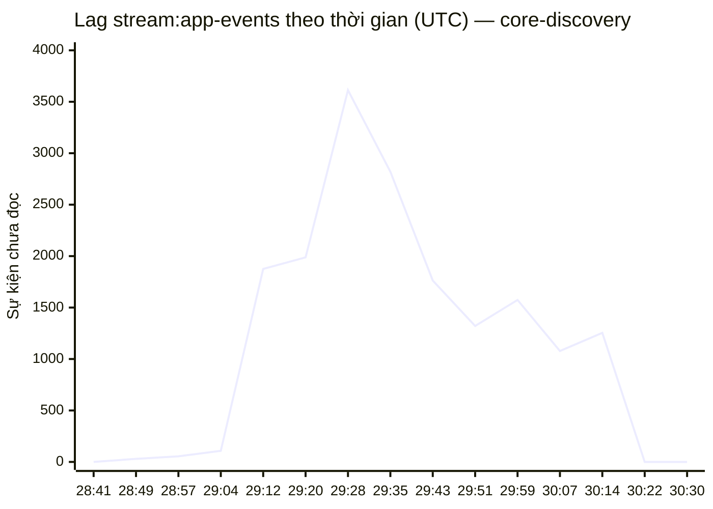

# TF120 — Đo tải feed trên staging (video qua CDN, 1 → 2 core-api, ghi qua stream)

- Jira: [SCRUM-192](https://tripflix.atlassian.net/browse/SCRUM-192) · Nhánh: `phong/TF120-do-tai-feed` · Người làm: Phong (dùng AI: có) · Ngày: 2026-11-27 (đo tối 26/11, 16:52–17:30 UTC)
- Báo cáo có biểu đồ tương tác: `docs/evidence/TF120-do-tai-feed.html` (mở bằng trình duyệt).

## Đã làm

- `tools/bench/feed-load/`: 3 kịch bản k6 (`scale.js`, `cdn.js`, `events.js`), `sample.sh` lấy mẫu server mỗi 5 giây (CPU từng container, Postgres, lag consumer), `run.sh` chạy theo mức và tự dừng khi lỗi quá 5%, `analyze.mjs` ghép số k6 với mẫu server.
- Bắn từ VM `tripflix-k6` (e2-standard-2, cùng region `asia-southeast1` với staging), qua router Traefik tạm bỏ rate limit cho riêng IP VM.
- Toàn bộ là **khách**: không tạo tài khoản, không phải dọn. Lượt xem giả dưới 2 giây trên bài dài từ 4 giây nên không vào điểm hot (`trend-signal.ts`), discovery bỏ qua khách. Đã kiểm trên stream: `isQualified: false`, `viewerId: null`.
- Staging lúc đo: VM e2 4 vCPU, 1 bản core-api `APP_ROLE=all` (trừ cấu hình 2), kiểm duyệt bật, 42.821 bài.

## Đối chiếu "Xong khi"

| Tiêu chí (chép từ Jira)                                                                  | Đạt | Bằng chứng                                                                                                                                                                                |
| ---------------------------------------------------------------------------------------- | --- | ----------------------------------------------------------------------------------------------------------------------------------------------------------------------------------------- |
| 3 phép đo có số và biểu đồ trong evidence                                                | Đạt | Mục "Kết quả" dưới đây và file HTML                                                                                                                                                       |
| Staging trả về như cũ: Traefik có rate limit (429), 1 bản core-api `all`, kiểm duyệt bật | Đạt | `server.yml` giống bản backup; bắn 200 req/s trong 8 giây: 494 lượt 200, 1.107 lượt 429; `APP_ROLE=all`, `core-api-2` và `core-api-worker` đã gỡ; `AI_SERVICE_URL=http://ai-service:8000` |
| VM k6 tắt                                                                                | Đạt | `gcloud compute instances stop tripflix-k6`                                                                                                                                               |

## Kết quả

### Phép 1 — Video qua CDN: người xem tăng 10 lần, CPU core-api gần như không đổi

Mỗi người ảo lấy cookie qua `POST /api/media/playback-session`, tải `master.m3u8`, playlist mức ≤ 540p, rồi các đoạn 2 giây theo nhịp phát; xem 3–8 đoạn thì vuốt sang reel khác, 10 reel gọi feed một lần. Mỗi mức 2 phút.

| Người xem | Video MB/s | Trúng cache CloudFront | p95 đoạn HIT | p95 đoạn MISS | CPU core-api (% 1 core) | Lỗi |
| --------- | ---------- | ---------------------- | ------------ | ------------- | ----------------------- | --- |
| 50        | 3,05       | 94,75%                 | 8 ms         | 586 ms        | 11                      | 0%  |
| 100       | 6,10       | 98,87%                 | 7 ms         | 571 ms        | 11                      | 0%  |
| 250       | 15,36      | 99,79%                 | 6 ms         | 569 ms        | 14                      | 0%  |
| 500       | 30,87      | 99,92%                 | 6 ms         | 579 ms        | 19                      | 0%  |

**Kết luận:** quyết định D3 (video trên S3 + CloudFront, server chỉ cấp cookie) đúng: băng thông video tăng 10 lần (3 → 31 MB/s), CPU core-api chỉ từ 11% lên 19%. Đoạn trượt cache đi về S3 Sydney mất khoảng 580 ms; từ 100 người xem, gần như mọi đoạn trúng cache (≥ 98,9%).

### Phép 2 — 1 → 2 core-api: thêm core-api không tăng sức chịu, nghẽn ở Postgres

Tốc độ cố định mỗi mức 60 giây. **Feed trộn:** 30% trang đầu "Dành cho bạn", 50% trang 2–5, 20% trang đầu "Đang hot". **Chỉ hot:** 30% trang đầu, 70% trang 2–5. Ngưỡng bền vững: p95 < 500 ms, lỗi < 1%. Cấu hình 1: 1 bản `all`. Cấu hình 2: 2 bản `api` + 1 `worker`, Traefik chia đều.

| Cấu hình | Kịch bản  | req/s  | p50 ms | p95 ms  | Lỗi   | CPU core-api % | CPU Postgres % |
| -------- | --------- | ------ | ------ | ------- | ----- | -------------- | -------------- |
| 1        | Feed trộn | 5      | 33     | 271     | 0%    | 25             | 48             |
| 1        | Feed trộn | **10** | 210    | **397** | 0%    | 9              | 119            |
| 1        | Feed trộn | 15     | 348    | 3.489   | 0%    | 24             | 308            |
| 1        | Feed trộn | 20     | 3.008  | 9.859   | 21,2% | 15             | 367            |
| 2        | Feed trộn | **5**  | 211    | **343** | 0%    | 35             | 87             |
| 2        | Feed trộn | 10     | 186    | 593     | 0%    | 43             | 122            |
| 2        | Feed trộn | 15     | 857    | 4.321   | 0%    | 39             | 292            |
| 2        | Feed trộn | 20     | 3.008  | 11.024  | 28,3% | 44             | 313            |
| 1        | Chỉ hot   | **50** | 28     | **42**  | 0%    | 30             | 72             |
| 1        | Chỉ hot   | 100    | 41     | 1.469   | 0%    | 65             | 173            |
| 1        | Chỉ hot   | 200    | 3.224  | 9.343   | 52,6% | 91             | 235            |
| 2        | Chỉ hot   | **50** | 26     | **67**  | 0%    | 54             | 78             |
| 2        | Chỉ hot   | 100    | 512    | 4.077   | 0%    | 112            | 222            |
| 2        | Chỉ hot   | 200    | 3.097  | 9.448   | 66,6% | 130            | 199            |

```mermaid
xychart-beta
  title "Feed trộn: p95 (ms) theo req/s — cột trước: cấu hình 1, cột sau: cấu hình 2"
  x-axis "req/s" [5, 10, 15, 20]
  y-axis "p95 ms" 0 --> 12000
  bar [271, 397, 3489, 9859]
  bar [343, 593, 4321, 11024]
```

**Kết luận:**

- Trần bền vững của staging: **feed trộn 10 req/s, tab hot khoảng 50–100 req/s**. Cấu hình 2 không hơn ở mức nào, vài mức còn tệ hơn.
- Nút thắt là **Postgres** (300–370% CPU trên 4 vCPU), không phải Node (core-api 10–45% của 1 core). Lỗi 500 là `timeout exceeded when trying to connect`: pool `content` (10 kết nối, chờ tối đa 3 giây) cạn vì mỗi câu chạy lâu. Thêm bản core-api thêm kết nối tranh cùng một Postgres nên không giúp.
- Nguyên nhân gốc: tab "Dành cho bạn" chấm điểm **cả 42.821 bài** ở mỗi lần đọc (mỗi request khoảng 250 ms lúc server nghỉ, Postgres đọc khoảng 360.000 dòng/giây ở 25 req/s). Trang 2 trở đi không qua cache. Tab hot (đọc theo bộ đếm có index) nhanh gấp khoảng 4 lần (60 ms).
- Đề xuất task mới: tính điểm "Dành cho bạn" trước theo lịch (như hot), hoặc giới hạn tập ứng viên trước khi chấm điểm. Mốc so sánh là bảng này.

### Phép 4 — Ghi qua stream: không lỗi, lag về 0 ngay khi ngừng bắn

500 VU tăng trong 30 giây, giữ 60 giây; mỗi VU gửi lô 3 lượt xem rồi nghỉ 2 giây. Tổng khoảng 56.000 sự kiện (giữ dưới giới hạn 100.000 của `stream:app-events`).

| VU  | req/s | Sự kiện/s  | p50    | p95    | Lỗi | Lag lớn nhất           | Về 0 sau khi dừng      | CPU core-api    |
| --- | ----- | ---------- | ------ | ------ | --- | ---------------------- | ---------------------- | --------------- |
| 500 | 177   | khoảng 530 | 179 ms | 691 ms | 0%  | 3.613 (core-discovery) | ≤ 8 giây (mẫu kế tiếp) | 101% của 1 core |

**Kết luận:**

- Quyết định D1 (ghi bất đồng bộ qua Redis Streams) đúng: 0 lỗi, ba nhóm consumer (`core-analytics`, `core-discovery`, `core-feed-trend`) đọc theo kịp, lag cao nhất 3.613 rồi về 0 trong vòng một mẫu sau khi k6 dừng (17:30:22).
- **Chưa đạt** ngưỡng p95 < 300 ms mình đặt: p95 691 ms vì core-api chạy kịch 1 core (101%). Ở tải này bước nhận sự kiện (kiểm schema, tra thời lượng bài, đẩy vào Redis) cùng consumer chạy chung một tiến trình. Đây là chỗ cấu hình 2 (tách worker) có thể giúp, chưa đo.

## Kết quả kiểm tra

- `k6 inspect` cả 3 kịch bản trên VM k6 (k6 v2.4.0): hợp lệ. Chạy thử nhẹ (2 req/s, 1 VU) cả 3 kịch bản trước buổi đo: 0 lỗi.
- `prettier --check tools/bench/feed-load/`: đạt. `node --check` các file JS: đạt.
- `analyze.mjs` chạy với số thật của buổi đo, ra đúng các bảng trên.
- `pnpm turbo run lint typecheck test --affected`: chưa chạy, worktree chưa cài `node_modules`. Thay đổi chỉ trong `tools/bench/feed-load/` và `docs/`, không đụng package nào.

## Cách kiểm lại

1. Làm theo `tools/bench/feed-load/README.md` (trước buổi đo, chạy, sau buổi đo).
2. Kéo `out/` của VM và thư mục mẫu `~/bench/feed-<giờ>/` của server về, chạy `node tools/bench/feed-load/analyze.mjs <out> <thư mục mẫu>`.

## Ảnh / video

- Không đổi giao diện. Biểu đồ trong file HTML đi kèm và các khối mermaid ở trên.

## Ảnh hưởng tới phần của người khác

- Có, chỉ về dữ liệu, không sửa code của ai:
  - Trang (analytics): `core-analytics` nhận khoảng 56.000 lượt xem giả của khách trong 17:28:43–17:30:22 UTC ngày 26/11. Lọc theo khoảng giờ này nếu cần.
  - Duy (discovery): lượt xem của khách bị bỏ qua, không ảnh hưởng gợi ý. Điểm hot không nhận vì lượt xem chưa đủ.
  - Người dùng staging: trong các mức quá tải (16:07–16:10 và rải rác 16:55–17:15 UTC, mỗi lần khoảng 1 phút) feed trả lỗi 500 hoặc chậm.
